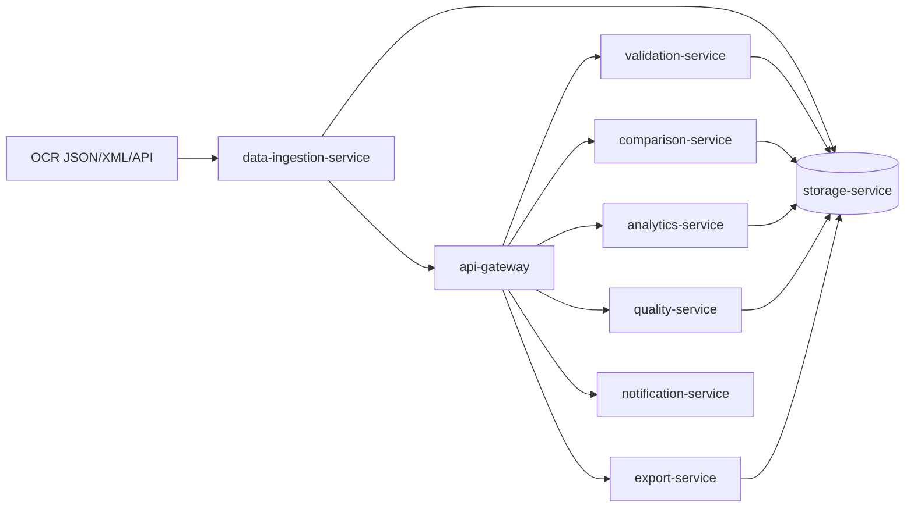

# Architecture

## Context

DocValidator Pro automates verification of extracted document data and supports operational business analysis over verified records.

## Service map

- `api-gateway`: entry point, JWT auth, orchestration, dashboard aggregation, rule proxy
- `data-ingestion-service`: imports OCR output from JSON/XML/API/manual channels, normalizes fields, starts auto-verification
- `validation-service`: format, arithmetic, semantic checks; anomaly scoring; auto-fix suggestions
- `comparison-service`: duplicate lookup, version linkage, field-level diff, suspicious change scoring
- `analytics-service`: document KPI, risk-of-non-payment forecast, fraud probability, period aggregations
- `quality-service`: manual review task generation, error visualization backend, OCR feedback collection
- `export-service`: export to ERP/CRM/EDM adapters, webhook dispatch, reconciliation act generation
- `storage-service`: canonical metadata and results store, rules and versions registry, audit log
- `notification-service`: critical and informational event notifications
- `frontend`: interactive quality and analytics cockpit with drill-down

## Infrastructure

- PostgreSQL for operational metadata and audit persistence target
- ClickHouse for analytical scale-out (period aggregates, risk slices)
- MinIO for artifacts and original document blobs
- Redis for cache-friendly hot data
- RabbitMQ and Redpanda for async integration pathways
- Docker Compose for local deployment

## Logical data flow

## Security model

- RBAC roles: `auditor`, `analyst`, `admin`
- JWT token issuance and validation in gateway
- Sensitive field encryption (phone, INN, passport-like values)
- Audit events for all state-changing operations

## Scalability notes

- Parallel batch validation endpoint in gateway (`/workflow/batch-validate`)
- Batch import endpoint in ingestion service (`/ingestion/batch`)
- Stateless service design for horizontal scaling
- Dedicated analytics service to isolate heavy read workloads
